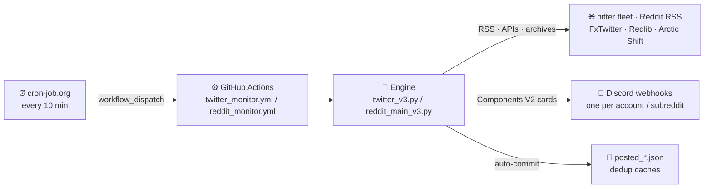

<div align="center">

# 📰 News Express

**X (Twitter) + Reddit → Discord monitor — 100% serverless.**

[](https://github.com/uesu/News-Express/actions/workflows/ci.yml)


A lightweight bot that watches public **X (Twitter) accounts** and **subreddits**
and posts every new item to **your own Discord channels** — one webhook per
account/subreddit — as rich *Components V2* cards with media galleries,
clickable buttons, and automatic **English translation** for non-English tweets.

**No bot token. No gateway. No server. Just GitHub Actions + Discord webhooks.**

[Quick start](#-quick-start) · [Features](#-features) · [Configuration](#-configuration) · [Engines](#-engines-v1v2v3) · [Testing](#-testing--verification) · [Troubleshooting](#-troubleshooting) · [Changelog](#-changelog)

</div>

---

## 📖 Contents

| | | |
|---|---|---|
| [How it works](#-how-it-works) | [Features](#-features) | [Engines (V1/V2/V3)](#-engines-v1v2v3) |
| [Repository contents](#-repository-contents) | [Quick start](#-quick-start) | [Configuration](#-configuration) |
| [Reddit delivery pipeline](#-reddit-delivery-pipeline) | [Testing & verification](#-testing--verification) | [Integrations](#-integrations) |
| [Troubleshooting](#-troubleshooting) | [Credits](#-credits--acknowledgments) | [Docs index](#-docs-index) |
| [Changelog](#-changelog) | [Final notes](#-final-notes) | |

---

## 🔁 How it works



* **Scheduling** — a free [cron-job.org](https://cron-job.org) job pings the two
  workflows every 10 minutes via `workflow_dispatch`. GitHub's native
  `schedule:` is **disabled on purpose** (it raced the external trigger →
  double posts; re-enabling is a documented two-line change — see
  [Setup step 4](#step-4--reliable-10-minute-automation-external-trigger)).
* **Memory** — posted IDs are cached in JSON files committed back to the repo
  by `github-actions[bot]`, so normal runs deduplicate against committed state.
* **Safety** — every PR must pass the offline
  [CI smoke gate](https://github.com/uesu/News-Express/actions/workflows/ci.yml)
  (`pip install` + `compileall` + two test suites) before merge.

---

## ✨ Features

### 🐦 X (Twitter) monitor

| | |
|---|---|
| **Rich cards** | *Components V2* container — media gallery, stats line, `🕐` Discord-native timestamp, per-tweet accent color |
| **Media** | photos, GIFs (re-rendered animated via a converter chain), videos with **real file-size probing** — oversized videos are swapped for the biggest playable mp4 variant, or thumbnail + "Watch on X" |
| **Full Articles** | article tweets post cover image, title, full body text and every in-article image/GIF |
| **Translation** | non-English tweets get a *Translated from X* block with the original preserved (via FxTwitter's `/en` endpoint); an identical "translation" (X language mis-detection) is dropped automatically |
| **Links** | clickable `#hashtags` and `@mentions`, exactly like fxtwitter embeds |
| **Self-heal** | Twitter V3 inspects Discord's returned message; unresolved videos (video-only by default) queue up to 4 bounded same-payload edits after posting, while healthy media is a no-op (`MEDIA_HEAL*` Variables) |
| **Resilient feeds** | an 11-instance nitter fallback fleet, ordered by live evidence; optional `NITTER_RSS_TOKEN` unlocks the token-gated instance |
| **Repost attribution** | reposted tweets credit the original author |

### 📰 Reddit monitor

| | |
|---|---|
| **Rich cards** | *Components V2* card built from **Reddit's own URLs** — every photo (up to 20 → two containers), best rendition each |
| **Video** | video posts show the **video only** (never a duplicate first-frame); quality-aware resolver — EmbedEZ 1080p when it validates, vxreddit as the reliable base, durable `v.redd.it` DASH as the floor — **never a silent video**, and signed/expiring URLs are never card media (see [video quality](docs/REDDIT_VIDEO_QUALITY.md)) |
| **YouTube** | thumbnail + animated `starwardspark3` button; optional real playback with `YOUTUBE_MEDIA_EMBED=1` |
| **Body text** | clean markdown body (links stay clickable, spoilers → Discord spoilers, empty-blockquote artifacts dropped, entities unescaped exactly once on every path) |
| **Readable tables** | Markdown tables become compact, grouped row blocks — a `Patch 3.7` label plus `- Column: value` bullets, entities decoded, FAQ/section spacing preserved — because Discord renders no table markdown; malformed tables and ordinary prose containing a pipe stay byte-identical |
| **Proxy-video cold-start heal** | Video cards inspect Discord's returned media metadata; only unresolved non-native video tiles with explicit evidence (a returned width/height ≤ 0) queue one same-message edit, and the edit revalidates the delivered card first and re-checks the exact queued video URL — omitted metadata is treated as unknown, not failure. Initially healthy videos, ordinary posts and native media are not touched (see [Round 72](docs/history/ROUND_72.md)) |
| **Feeds** | one **combined RSS request** for all subreddits (fits Reddit's ~1 req/min datacenter limit) with automatic per-subreddit fallback; the optional `REDDIT_FEED_TOKEN` moves requests to the logged-in tier |
| **FULL MODE** | with an optional Reddit script app: 💬/👍 stats, the OP's stickied comment, and true crosspost embeds |
| **Fallback fleet** | proxy services (vxreddit → redditez → Embeddit rewrite — the priority/tie-break order, dispatched as bounded concurrent waves with Embeddit held back), Redlib instances, and the Arctic Shift archive — a dead source never breaks a run |
| **Delivery checks & state** | dedup, stateless fresh-age and pristine `/new` checks, plus operational pending rechecks for selected liveness/media-readiness holds; optional post-delivery retraction (see [the delivery pipeline](#-reddit-delivery-pipeline)) |
| **Listing-safe delivery** | cache-busted `/new` confirmation posts an item on the first tick it is visible; listing outages are never treated as proof of absence |

### 🧱 Platform

* 🎯 **Multi-webhook routing** — every account/subreddit posts to its own channel.
* 🕐 **Exact timestamps** — every card's stats line ends with a Discord-native `<t:…:f>` timestamp.
* 🔘 **Customizable buttons** — link-style buttons with Unicode or custom server emoji.
* 🕙 **Reliable automation** — external cron trigger, cache auto-commits, per-run flood caps.
* 🧪 **Two offline test suites** — smoke + signals, no network, no secrets; every past bug is a named guard (`rNN: ...`).
* 🤖 **Dependabot-ready** — weekly dependency/action checks, grouped PRs when requirements need updates, CI-gated, optional auto-merge.

---

## 🔀 Engines (V1/V2/V3)

Both monitors ship **three interchangeable engines** — same monitoring, same
routing, different Discord rendering. Switch by editing one `run:` line in the
workflow; all engines are enrolled in the smoke suite and stay working.

**X (Twitter)** — edit `.github/workflows/twitter_monitor.yml`:

| | `twitter_v1.py` | `twitter_v2_button_outside.py` | `twitter_v3.py` — **active** |
|---|---|---|---|
| Look | Plain text + fxtwitter link (Discord auto-unfurls) | Components V2 card, buttons **outside** | Components V2 card, buttons **inside** |
| Cost | Free | Free | Free |

```yaml
# run: python "testing area/twitter_v1.py"               # V1
# run: python "testing area/twitter_v2_button_outside.py" # V2
run: python "testing area/twitter_v3.py"                 # V3 (active)
```

**Reddit** — edit `.github/workflows/reddit_monitor.yml`:

| | `reddit_main.py` (V1) | `reddit_main_v2_embedez.py` (V2) | `reddit_main_v3.py` (V3 — **active**) |
|---|---|---|---|
| Cost | **Free, no API key** | EmbedEZ API key (paid credits) | **Free, no API key** |
| Look | `redditez.com` link, Discord auto-embeds | Components V2 card from EmbedEZ | Components V2 card from Reddit's own URLs |
| Media | whatever the mirror unfurls | via EmbedEZ | every photo, video-only video posts, native video chain |

```yaml
# run: python "testing area/reddit_main.py"             # V1
# run: python "testing area/reddit_main_v2_embedez.py"  # V2
run: python "testing area/reddit_main_v3.py"            # V3 (active)
```

> Engines are independent — mix and match freely (e.g. X on V3, Reddit on V1).

---

## 🗂 Repository contents

```
├── .github/
│   ├── dependabot.yml             # Dependabot: weekly pip + actions update PRs (optional)
│   └── workflows/
│       ├── twitter_monitor.yml    # X/Twitter — runs testing area/twitter_v3.py
│       ├── reddit_monitor.yml     # Reddit — runs testing area/reddit_main_v3.py
│       ├── ci.yml                 # PR gate: install + compile + offline smoke suites
│       ├── dependabot_auto_merge.yml  # opt-in auto-merge for Dependabot PRs
│       └── python_version_bump.yml    # verified CPython patch/minor PR workflow
├── docs/                          # decision records + guides (see Docs index below)
├── testing area/                  # the engines (see Testing)
│   ├── twitter_v1.py · twitter_v2_button_outside.py · twitter_v3.py
│   ├── twitter_proxy.py           # X tweet-data fallback chain
│   ├── reddit_main.py · reddit_main_v2_embedez.py · reddit_main_v3.py
│   ├── reddit_proxy.py            # Reddit proxy services + health state
│   ├── reddit_signals.py          # pure Reddit gate/decision functions
│   └── video_diag.py              # X video tile diagnostic
├── tests/
│   ├── test_smoke.py              # offline smoke suite (run by CI)
│   ├── test_reddit_signals.py     # pure gate/unit suite
│   └── fixtures/posted_cards.py   # production-card replay fixtures
├── AGENTS.md                      # onboarding for AI coding agents
├── posted_tweets.json · posted_reddit.json · pending_reddit.json · proxy_health.json
│                                  # auto-committed runtime caches
├── PRIVACY_POLICY.md · TERMS_OF_SERVICE.md
├── requirements.txt               # feedparser, aiohttp, python-dotenv
├── .env.example                   # local testing template + every switch documented
└── .gitignore
```

> `posted_messages.json` (retraction state) is created only when the
> retraction seatbelt is enabled, and is gitignored for local work.

---

## 🚀 Quick start

### Step 0 — Make the repo your own (**do NOT fork**)

Forked repos get Actions disabled and auto-disabled again after ~60 days of
inactivity — your bot would silently stop. Instead:

1. **Code → Download ZIP** on the source repo, unzip locally.
2. Create a **brand-new empty repository** on your GitHub account.
3. *Uploading an existing file* → drag in **all** files, including the hidden
   `.github` folder (enable *show hidden files* first).
4. Commit. Verify *Settings → Actions → General → Workflow permissions →
   **Read and write** permissions*.

### Step 1 — Create Discord webhooks

For each target channel: *Channel Settings → Integrations → Webhooks → New
Webhook → Copy URL.*

### Step 2 — Add repository secrets

*Settings → Secrets and variables → Actions → New repository secret* — add
what you need from the [Configuration](#-configuration) tables: `ACCOUNTS`,
one `WEBHOOK_<ACCOUNT>` per X account, `SUBREDDITS`, one
`WEBHOOK_REDDIT_<SUB>` per subreddit, plus the recommended
`REDDIT_FEED_TOKEN` and optional `DISCORD_WEBHOOK_URL` fallback.

### Step 3 — Reset the caches for a fresh start

Set `posted_tweets.json` and `posted_reddit.json` to just `[]`. On the first
run the bots post only the **single newest item** per account/subreddit (by
design — no channel flooding).

### Step 4 — Reliable 10-minute automation (external trigger)

GitHub's built-in `schedule:` can lag 15–60 min or skip runs, so an external
cron does the triggering:

1. **Create a PAT for the external cron only.** Prefer a fine-grained token
   scoped to this repository with **Actions: write** permission (classic PATs
   also work with `workflow`, plus `repo` if the repository is private). Store
   it only in cron-job.org, never in this repository or chat.
2. Sign up at [cron-job.org](https://cron-job.org) (free) and create a job
   **per workflow**:
   * **URL:** `https://api.github.com/repos/<YOU>/<REPO>/actions/workflows/twitter_monitor.yml/dispatches`
     (and a second job for `reddit_monitor.yml`)
   * **Method:** `POST` · **Crontab:** `*/10 * * * *`
   * **Headers:**

     | Key | Value |
     |---|---|
     | `Authorization` | `token <YOUR_PAT>` |
     | `Accept` | `application/vnd.github+json` |
     | `Content-Type` | `application/json` |

   * **Body:** `{"ref":"main"}` (match your default branch)
3. **Test run** → expect `204 No Content` (or `200 OK`), then check the
   Actions tab. `401` = bad token/scope; `404` = wrong repo/workflow/branch.

> ⚠️ The in-file `schedule:` is **disabled on purpose** — it raced the
> external trigger and double-posted (2026-09-17). To re-enable it, uncomment
> the two lines in the workflow **and** pause the cron-job.org job.

### Step 5 — Test end-to-end

*Actions → select the workflow → Run workflow* — check the right channels got
the right posts, buttons render, and the cache file shows a new
`github-actions[bot]` commit. New or changed scripts are proven from the
[`testing area/`](#-testing--verification) first.

<details>
<summary><b>(Optional) Render Cron instead of GitHub Actions</b></summary>

Create a **Cron Job** on Render: build `pip install -r requirements.txt`,
command `python "testing area/twitter_v3.py"` (or any other engine file),
schedule `*/10 * * * *`, and add the same environment variables there.

</details>

---

## 🔧 Configuration

### Secrets

**X (Twitter) monitor**

| Secret | Value |
|---|---|
| `ACCOUNTS` | Comma-separated handles, e.g. `TYPEII_EN,PomPom_HonkaiSR,Wuthering_Waves,HonkaiNA,Ananta_EN` |
| `WEBHOOK_<ACCOUNT>` | One per account — `WEBHOOK_` + name **UPPERCASED**, non-alphanumerics → `_` (e.g. `PomPom_HonkaiSR` → `WEBHOOK_POMPOM_HONKAISR`) |
| `DISCORD_WEBHOOK_URL` *(optional)* | Catch-all fallback for accounts without their own secret |
| `NITTER_RSS_TOKEN` *(optional)* | miningtcup's DogWAF token — unlocks the token-gated `nitter.miningtcup.me` (X) and `redlib.miningtcup.me` (Reddit). A secret (not a Variable) so GitHub masks it in logs |

**Reddit monitor**

| Secret | Value |
|---|---|
| `SUBREDDITS` | Comma-separated subreddit names |
| `WEBHOOK_REDDIT_<SUB>` | One per subreddit — `WEBHOOK_REDDIT_` + name **UPPERCASED**, non-alphanumerics → `_` |
| `REDDIT_FEED_TOKEN` *(optional — **recommended**)* | Your personal Reddit feed token: `old.reddit.com/prefs/feeds` → any feed link ends with `?feed=<token>` — copy just the token. Moves RSS requests to the logged-in rate tier (429s essentially stop) |
| `REDDIT_CLIENT_ID` + `REDDIT_CLIENT_SECRET` *(optional — V3)* | Reddit **script app** (reddit.com/prefs/apps → type "script" → redirect `http://localhost`). Enables V3 **FULL MODE** (stats, OP comment, crosspost embeds) via OAuth. V3 works without it; drop both secrets in whenever the app exists and FULL MODE turns on with no code change |
| `EMBEDEZ_API_KEY` | **V2 only** — from your embedez.com dashboard |
| `DISCORD_WEBHOOK_URL` *(optional)* | Catch-all fallback |

### Variables (repo **Variables**, not secrets — all optional, defaults shown)

**Reddit V3 — media & card**

| Variable | Default | Meaning |
|---|---|---|
| `PROXY_MEDIA` | `1` | `0` = keep the native RSS/media fallback only (skip the proxy services) |
| `PROXY_VIDEO_HEAL` | `1` | `0` = disable response-based, same-message repair for unresolved non-native video tiles (queued only on explicit evidence: a returned width/height ≤ 0) |
| `PROXY_VIDEO_HEAL_DELAY` | `6` | seconds before the revalidated edit, clamped to 0–60. Initially healthy videos receive no edit, delay, or revalidation; a card flagged as a candidate may receive the configured delay and one revalidation GET, but receives no PATCH if it has rendered by then |
| `PROXY_WARMUP_POST` | `HonkaiStarRail_leaks/1whbjbh` | stable public post used to skip proxy services that are down this run |
| `EMBEDDIT_INSTANCE` | `https://embeddit.deltandy.me` | bare host, host:port, or full URL |
| `PROXY_WAVE_DELAY` | `0.5` | seconds before the 3rd proxy service joins the parallel dispatch |
| `PROXY_GALLERY_GRACE` | `1.5` | max wait for a more complete gallery |
| `PROXY_MAX_CONCURRENCY` | `8` | global cap on in-flight proxy requests |
| `YOUTUBE_MEDIA_EMBED` | `off` | `1` = also try to **play** YouTube links (seaof.glass, +up to ~3 min probes/post) |
| `YOUTUBE_LINK_MESSAGE` | `1` | `0` = don't post the second bare YouTube link (playable embed) after the card |
| `REDDIT_OP_COMMENT` | `on` | `0` = hide the 💬 OP comment line (FULL MODE) |
| `DISCOHOOK_PREVIEW` | `on` | `0` = don't create/log the per-card Discohook share-link preview |
| `REDDIT_MIRROR` *(V1 only)* | `redditez.com` | embed mirror host: `embeddit.deltandy.me` or `vxreddit.com` |

**Reddit V3 — delivery & gates**

| Variable | Default | Meaning |
|---|---|---|
| `FRESH_HOLD_SECONDS` | `30` | flat minimum post age before a candidate is considered; `0` = off |
| `LISTING_CONFIRM` | `1` | `0` = disable the pristine `/new` listing confirmation (restores round-63 delivery) |
| `PENDING_RECHECK_SECONDS` | `1800` | shared throttle for retryable operational holds; confirmed removed/deleted archive entries use a no-recheck path unless they reappear via RSS |
| `REDDIT_VIDEO_QUALITY` | `balanced` | video-quality selection: `balanced` (EmbedEZ 1080p may replace vxreddit → 720p → durable DASH floor), `compatibility` (pre-round-67 order, instant rollback), `highest` (wider quality window) |
| `RETRACT_DEAD_POSTS` | `0` | `1` enables the dead-post retraction seatbelt |
| `RETRACT_MODE` | `edit` | `edit` (tombstone in place) or `delete` |
| `RETRACT_WINDOW_SECONDS` | `21600` | how far back a delivered post can still be retracted (6 h) |

**Caches & caps**

| Variable | Default | Meaning |
|---|---|---|
| `MAX_CACHE_SIZE_PER_SUB` | `250` | newest dedup keys kept **per subreddit** |
| `MAX_CACHE_SIZE_PER_ACCOUNT` | `250` | newest dedup keys kept **per X account** |
| `MAX_CACHE_SIZE_TOTAL` | `10000` | global dedup backstop |
| `MAX_POSTS_PER_RUN` | `25` | per-run flood cap — newest N post, the rest retry next run (48 h window) |

**X (Twitter) monitor**

| Variable | Default | Meaning |
|---|---|---|
| `MEDIA_HEAL` | `on` | `off` = disable the post-posting media re-edit pass |
| `MEDIA_HEAL_SCOPE` | `video` | `on`/`all` = also heal photos/gif/webp; `off` = never re-edit |
| `MEDIA_HEAL_DELAY_SECONDS` | `45` | wait before each re-edit (30–60 is sane) |
| `MEDIA_HEAL_ATTEMPTS` | `4` | max same-payload re-edits per message; hard-capped at 4 |

**FULL MODE probe**

| Variable | Default | Meaning |
|---|---|---|
| `REDDIT_JSON_PROBE` | `auto` | when the feed-token `.json` probe runs: `auto` = only when both OAuth secrets exist; `force` = always; `off` = never |
| `FEEDTOKEN_JSON_STAGGER` | `65` | seconds between feed-token `.json` attempts |

**Test tools** (local `.env` or manual workflow runs — never in scheduled runs)

| Variable | Meaning |
|---|---|
| `TEST_TWEET_ID` | rebuild one specific tweet: `screen_name/tweet_id` (also the `test_tweet` workflow input) |
| `TEST_POST_ID` | rebuild one specific Reddit post: `Subreddit/post_id` (also the `test_post` workflow input) |
| `DRY_RUN` | `1` = log full card payloads, touch neither Discord nor the cache (also the `dry_run` workflow input) |

### Customizing the buttons

Near the top of each engine:

```python
READ_POST_LABEL = "Read Post"
READ_POST_EMOJI = {"name": "📖"}        # Unicode emoji — or None
STATIC_BUTTONS = [
    {"label": "Citlali News", "url": "https://discord.gg/HyrVP9wRXu", "emoji": {"name": "✨"}},
    {"label": "Donate",     "url": "https://ko-fi.com/jieunlatte",   "emoji": {"name": "☕"}},
]
```

* Max **5 buttons per row** (Discord limit).
* **Custom server emoji:** type `\:emojiname:` in Discord to get its ID, then
  `"emoji": {"id": "123456789012345678", "name": "emojiname", "animated": False}`.

---

## 📬 Reddit delivery pipeline

Current behavior (rounds 63–72). For the full history of how this evolved,
see [`docs/history/ENGINE_HISTORY.md`](docs/history/ENGINE_HISTORY.md) and the
[changelog archive](docs/history/CHANGELOG_ARCHIVE.md).

**A post delivers when, in order:**

1. **Dedup cache** — already posted? skip. (`<subreddit>_<post_id>` key, retained per the cache caps above.)
2. **Pending recheck throttle** — retryable operational holds already recorded
   for a candidate are re-evaluated according to `PENDING_RECHECK_SECONDS`
   (default 1800 s). Confirmed removed/deleted archive entries use a no-recheck
   path unless they reappear via RSS.
3. **Fresh hold** — a flat, stateless `FRESH_HOLD_SECONDS` (30 s) minimum age
   computed from the post's own timestamp. This check itself creates no
   tracker or pending entry.
4. **Pristine listing confirmation** — a cache-busted read of the
   subreddit's `/new` listing (unique `_fresh=` buster + `no-cache` headers,
   never reused across runs) proves the post is live right now. Not listed
   yet → skipped this tick only — never blocked, never cached; it posts the
   tick it first appears. All listing sources down → treated as an outage,
   never as absence.
5. **Operational liveness/media checks** — source evidence about a post's
   liveness or removal/approval state, or incomplete archive media, can defer
   delivery. Retryable holds are recorded with a reason in
   `pending_reddit.json` and revisited on the configured interval; the
   removed/deleted no-recheck exception above still applies.
6. **Deliver** — the card posts; the dedup key is cached.

The round-64 fresh-age and pristine-listing skips remain stateless; they do not
write `pending_reddit.json`. The active operational pending cache is separate
from the removed Round-63 settle-window, dedicated moderator-queue, and
duplicate-media/repost gates. Round 67 also removed the content-advisory gate
and its four Variables, so the monitor makes no content-based posting decision
on any path. The truthful record of that removal lives in
[`docs/history/ROUND_67.md`](docs/history/ROUND_67.md).

**After delivery (opt-in):** the **retraction seatbelt** (`RETRACT_DEAD_POSTS=1`,
off by default) can rewrite a confirmed-dead post's card as a tombstone (or
delete it), but only with two independent proofs, and it never touches the
dedup key — a retraction can never cause a re-post.

**Latency:** delivery happens on the first tick a post clears the checks —
latency is simply your cron interval (10 min by default; 2-minute crons are
proven fine post-round-64).

---

## 🧪 Testing & verification

### The offline suites (run before every commit)

```bash
python3 tests/test_smoke.py           # expect: SMOKE TEST: ALL PASS
python3 tests/test_reddit_signals.py  # expect: ALL PASS
```

No network, no secrets — the suites stub `aiohttp`/`feedparser`/`dotenv`.
CI runs both on every PR (see [`docs/CI_SMOKE.md`](docs/CI_SMOKE.md)).

### The `testing area/` procedure

Every new or changed script is proven **before** it touches production:

1. The updated script lives in `testing area/` first — never run an unproven
   script from the repo root.
2. Point the workflow's `run:` line at the test copy (double quotes required —
   the folder name has a space): `run: python "testing area/reddit_main_v3.py"`.
3. Check two things: the actual posts in Discord (layout, buttons, media) and
   the workflow log — every skipped source/instance is logged.
4. Once both look right, commit. The same guidance is written as a comment
   block inside both workflow files, right above the `run:` line.

### Dry runs & test posts (Reddit workflow inputs)

*Actions → "Reddit Feed Monitor" → Run workflow:*

* **`dry_run` = yes, `test_post` empty** — lists every post it *would* post
  with complete card payloads. Discord is NOT touched, the cache is NOT
  saved. Key log lines: `Combined feed OK: …`, `post JSON …` (full or native
  mode), `DRY RUN (Discord NOT touched): …`.
* **`test_post` = `<Subreddit>/<post_id>`** (with `dry_run` = no) — rebuilds
  one specific old post into the channel, e.g.:

  | `test_post` value | Post type | Expect |
  |---|---|---|
  | `AnantaLeaks/1wguffh` | 3-photo gallery | all 3 photos, full-res |
  | `AnantaLeaks/1wgq3cy` | YouTube link post | video tile only + animated button |
  | `HonkaiStarRail_leaks/1wguwvw` | Reddit video | video tile only, no dup first-frame |

* **X:** the `test_tweet` input rebuilds one tweet via the direct FxTwitter
  path (nitter-free), e.g. `Wuthering_Waves/2100555373073797461`.

### Local testing

```bash
pip install -r requirements.txt
cp .env.example .env   # then fill in your values
```

`.env.example` documents **every** switch with its default. Then run any
engine directly, e.g. `python "testing area/reddit_main_v3.py"` (quote the
path — the folder name contains a space).

---


## 🐍 Runtime, dependencies, and production scope

* **Current runtime:** exact CPython **3.14.8** in CI and both monitor
  workflows. The official Python 3.14.8 release page lists **September 30,
  2026** as its release date.
* **Version terms:** `MAJOR.MINOR.PATCH` — `3.14.7 -> 3.14.8` is a **patch**
  update, `3.14.8 -> 3.15.0` is a new **minor** series, and `3.x -> 4.x` is a
  **major** update.
* **Runtime automation:** `.github/workflows/python_version_bump.yml` checks for
  final stable candidates in the `actions/python-versions` manifest, requires
  wheels-only dependency installation (`pip install --only-binary=:all:`), runs
  compileall + both offline suites before and after the allowlisted rewrite, and
  opens a PR only after those gates pass.
* **Auto-merge boundary:** `AUTO_MERGE_PYTHON_BUMP=yes` permits eligible patch
  auto-merges only. Python 3.15 remains a manual-review minor-series PR, and
  Python 4 or any other major update requires deliberate migration. There is no
  direct-to-main fallback and no `all` auto-merge mode.
* **Authentication:** runtime bump publication uses `BUMP_PAT` only through
  GitHub Actions secret references (`secrets.BUMP_PAT`). Secret values and
  personal tokens must never be committed.
* **Production scope:** this development repository does not copy its docs or
  historical audit records into production. The Reddit and X production repos
  have separate production-only workflow updates and caches.

See [`docs/PYTHON_RUNTIME.md`](docs/PYTHON_RUNTIME.md) for the full policy and
[`docs/DEPENDABOT.md`](docs/DEPENDABOT.md) for dependency automation.

## 🔗 Integrations

| Integration | What it does | Docs |
|---|---|---|
| **Discohook** | after each Reddit post, a share-link preview of the exact card is logged (keyless public API, no webhook URL ever leaves the repo; disable with `DISCOHOOK_PREVIEW=0`) | [`docs/DISCOHOOK.md`](docs/DISCOHOOK.md) |
| **Dependabot** | weekly dependency/action checks; grouped PRs when requirements need updates; optional opt-in auto-merge (`AUTO_MERGE_DEPENDABOT=yes`) | [`docs/DEPENDABOT.md`](docs/DEPENDABOT.md) |
| **Python runtime** | CPython pinned to exact stable **3.14.8**; patch bumps may auto-merge only with `AUTO_MERGE_PYTHON_BUMP=yes`, new minor series require manual review, major versions require manual migration | [`docs/PYTHON_RUNTIME.md`](docs/PYTHON_RUNTIME.md) |
| **CI** | every PR: `pip install` + `compileall` + smoke suite + Reddit signal suite | [`docs/CI_SMOKE.md`](docs/CI_SMOKE.md) |

---

## 🚨 Troubleshooting

* **Buttons don't render** — every webhook POST needs `?with_components=true`
  (Discord silently drops components without it — already handled in all
  scripts). Rich cards also set the `IS_COMPONENTS_V2` flag (`1 << 15`).
* **X run logs `NO working nitter instance this run` / `ALL FEEDS FAILED`** —
  the whole nitter fleet was down/stale. Check
  [status.d420.de](https://status.d420.de/) and refresh `RSS_INSTANCES` in
  `testing area/twitter_v3.py`; set `NITTER_RSS_TOKEN` for the token-gated
  instance. Rebuild one missed tweet meanwhile: *Run workflow* →
  `test_tweet` = `screen_name/tweet_id`.
* **`Could not fetch valid RSS feed for @…` / `r/…`** — public mirrors
  rotate/die; the engines fall back automatically (read the per-source log
  lines). Historical incidents: [`docs/history/ENGINE_HISTORY.md`](docs/history/ENGINE_HISTORY.md).
* **`HTTP 429 for r/…`** — Reddit's anonymous datacenter rate limit
  (~1 req/min per IP). The combined-feed fetch normally fits it, non-feed
  HTML ("loading takes a moment") is rejected automatically, and the engine
  falls back to per-subreddit fetches with retries; the permanent fix is the
  `REDDIT_FEED_TOKEN` secret.
* **No run at 10-minute marks** — GitHub's native cron is best-effort; that's
  why cron-job.org does the triggering. It's also immune to GitHub's 60-day
  schedule auto-disable.
* **Reddit V2 posts "Limited preview" cards** — missing/invalid
  `EMBEDEZ_API_KEY` or out of credits; switch to free V1/V3.
* **First run posts only one item per account** — intentional anti-flood
  behavior; backfill starts on subsequent runs.
* **A big video shows as a thumbnail / "smaller version" note (X)** — intended:
  the file exceeded the ~256 MB Discord gallery limit (`VIDEO_SIZE_LIMIT`,
  tunable). The card still plays a smaller rendition or links out to X.
* **A video tile says "image not found" (X)** — rare, transient Discord proxy
  hiccup (the same URL plays fine when re-posted). Delete the message →
  remove the tweet from `posted_tweets.json` → re-run. If it ever becomes
  frequent, lower `GALLERY_VIDEO_LIMIT`.
* **A GIF shows as a video player instead of an animated image** — every GIF
  converter was unreachable at post time; the mp4 is the safe fallback. They
  recover on their own.
* **A portrait/vertical video loads but won't play right after posting** —
  transient Discord proxy warm-up (plays fine shortly after). If you ever
  confirm *persistent* portrait breakage, set `PORTRAIT_PROXY = True` near
  the top of the X engine.
* **EmbedEZ suddenly errors after an update** — expected risk (their docs
  warn of breaking changes); the log prints the raw API response.
* **`Deprecation` / `Node.js 20 is deprecated` warnings in Actions logs** —
  cosmetic; removed by the Dependabot action bumps to v7 (Node 24). See
  [`docs/DEPENDABOT.md`](docs/DEPENDABOT.md).

---

## 🌟 Credits & acknowledgments

This project stands on the shoulders of these open-source projects and free
services — please support them:

| Project / Service | What it's used for | Links |
|---|---|---|
| **News-Flash-Bot** by [@cold-logic5](https://github.com/cold-logic5) | The original repository this project is based on (RSS → Discord webhook architecture) | [GitHub repo](https://github.com/cold-logic5/News-Flash-Bot) · [Author](https://github.com/cold-logic5) |
| **Nitter** by [@zedeus](https://github.com/zedeus) | Free & open-source, privacy-focused X/Twitter front-end providing the RSS feeds — active fallback order reviewed 2026-10-03 (round 59, feed-body audit): [nitter.cf](https://nitter.cf/), [xitter.cf](https://xitter.cf/), [nitter.kareem.one](https://nitter.kareem.one/) (runs [shaquille's fork](https://git.kareem.one/shaquille/nitter)), [tw.eir-nya.gay](https://tw.eir-nya.gay/) ("kitter", eir's fork based on [Cynosphere's fork](https://gitlab.com/Cynosphere/nitter)), [nitter.meowing.monster](https://nitter.meowing.monster/), [shitter.thepixora.com](https://shitter.thepixora.com/), [nitter.miningtcup.me](https://nitter.miningtcup.me/) (RSS token), then last-resort [nitter.netbub.com](https://nitter.netbub.com/) + [nitter.jaydenha.uk](https://nitter.jaydenha.uk/) | [GitHub](https://github.com/zedeus/nitter) · 💖 [Donations](https://github.com/zedeus/nitter#donations) |
| **FxTwitter / FxEmbed** by [@dangered wolf](https://github.com/dangeredwolf) | Rich X/Twitter embeds + the free API — primary tweet-data source (round 11) used for media, stats, translation, GIF re-rendering and the video proxy | [fxtwitter.com](https://fxtwitter.com) · [docs.fxembed.com](https://docs.fxembed.com/) · 💖 [Sponsor](https://github.com/sponsors/dangeredwolf) |
| **vxtwitter (BetterTwitFix / fixvx)** | Backup tweet-data API (round 11) + its **gifconvert** GIF converter | [vxtwitter.com](https://vxtwitter.com) · [API docs](https://vxtwitter.com/api.md) |
| **EmbedEZ** | Rich Reddit embeds (redditez.com mirror) + the provider API used by Reddit V2 + last-resort tweet-data source (round 11) | [embedez.com](https://embedez.com/) · [API docs](https://embedez.com/docs) |
| **Embeddit** by [@DeltAndy123](https://github.com/DeltAndy123) | Alternative Reddit embed mirror (credited — its button was removed in the 2026-09-11 trim) | [GitHub](https://github.com/DeltAndy123/Embeddit) |
| **vxReddit** by [@dylanpdx](https://github.com/dylanpdx) | Alternative Reddit embed mirror (credited — its button was removed in the 2026-09-11 trim) | [vxreddit.com](https://vxreddit.com) · [GitHub](https://github.com/dylanpdx/vxreddit) |
| **Redlib** (community instances) | Reddit front-end mirrors used as RSS fallback sources — refreshed 2026-09-30; **redlib.miningtcup.me** is the optional token-backed V3 fallback (fails closed) | [redlib-instances](https://github.com/redlib-org/redlib-instances) · [redlib](https://github.com/redlib-org/redlib) |
| **Arctic Shift** by [@ArthurHeitmann](https://github.com/ArthurHeitmann) | Optional Reddit archive JSON for V3 crosspost originals, ordered galleries, text/media fallbacks, and the per-subreddit search backup feed (round 17). Archive freshness varies — archived counts are labelled on the card | [GitHub](https://github.com/ArthurHeitmann/arctic_shift) · [Website](https://arctic-shift.photon-reddit.com/) · [Download tool](https://arctic-shift.photon-reddit.com/download-tool) |
| **cron-job.org** | Free external scheduler that triggers the workflows reliably every 10 minutes | [cron-job.org](https://cron-job.org) |
| **GitHub Actions** | Runs everything on a schedule, for free | — |
| **Discord Webhooks** | Delivers messages to channels statelessly | — |

Huge respect and gratitude to [@cold-logic5](https://github.com/cold-logic5)
for the original architecture, to the Nitter project — if you can,
[support zedeus here](https://github.com/zedeus/nitter#donations) — and to
[@dangered wolf](https://github.com/dangeredwolf), creator and lead developer
of FxTwitter/FxEmbed — [donations welcome](https://github.com/sponsors/dangeredwolf).

---

## 📚 Docs index

| Document | Contents |
|---|---|
| [`docs/CHANGELOG.md`](docs/CHANGELOG.md) | Current changelog — round 63 onward (newest first) |
| [`docs/history/CHANGELOG_ARCHIVE.md`](docs/history/CHANGELOG_ARCHIVE.md) | Full dated history, rounds 1–62 |
| [`docs/history/ENGINE_HISTORY.md`](docs/history/ENGINE_HISTORY.md) | Round-by-round engine notes moved out of this README (2026-10-05) |
| [`docs/history/ROUND_*.md`](docs/history/) | Decision records per incident |
| [`docs/history/REPOSITORY_TRACKING_2026-10-01.md`](docs/history/REPOSITORY_TRACKING_2026-10-01.md) | File/config/policy inventory and audit record (historical snapshot, 2026-10-01) |
| [`docs/REDDIT_VIDEO_QUALITY.md`](docs/REDDIT_VIDEO_QUALITY.md) · [`docs/REDDIT_VIDEO_MEDIA_REPORT.md`](docs/REDDIT_VIDEO_MEDIA_REPORT.md) · [`docs/VIDEO_ONLY_QUALITY_POLICY_CONFIRMATION.md`](docs/VIDEO_ONLY_QUALITY_POLICY_CONFIRMATION.md) | Round-67 video-quality policy, evidence report, and the confirmed acceptance policy |
| [`docs/CI_SMOKE.md`](docs/CI_SMOKE.md) · [`docs/DEPENDABOT.md`](docs/DEPENDABOT.md) · [`docs/DISCOHOOK.md`](docs/DISCOHOOK.md) · [`docs/PYTHON_RUNTIME.md`](docs/PYTHON_RUNTIME.md) | Topic guides |
| [`PRIVACY_POLICY.md`](PRIVACY_POLICY.md) · [`TERMS_OF_SERVICE.md`](TERMS_OF_SERVICE.md) | Policies |

---

## Workflow observability

The Reddit and Twitter monitor workflows capture each monitor's local output
and write a GitHub Actions Step Summary after cache persistence.

The summaries report runtime, feed and post counters, provider and video
diagnostics where applicable, delivery results, and cache status. The Reddit
summary includes provider and video diagnostics; the Twitter summary focuses on
feed, entry, delivery, runtime, and cache status. Summary generation is
local-only and does not add feed, provider, media, Discord, retry, scheduling,
or cache-selection work to the monitor path.

The Twitter workflow supports these post-delivery media-heal controls:

- `MEDIA_HEAL` — enables or disables healing; default: enabled.
- `MEDIA_HEAL_SCOPE` — defaults to `video`; `off` disables healing and `on`/`all`
  includes additional media types.
- `MEDIA_HEAL_DELAY_SECONDS` — delay before each re-edit; default: 45 seconds.
- `MEDIA_HEAL_ATTEMPTS` — maximum same-payload re-edits; default: 4, hard-capped
  at 4.

Twitter V3 requests Discord's created-message response (`wait=true`) and
inspects the returned media metadata. Only unresolved media eligible for the
configured scope is added to an in-memory message repair queue; the queue runs
after the posting loop and re-edits the same payload up to the configured
attempt cap. The default scope is video-only, and healthy media gets no edit.
This per-message Twitter repair queue is not persisted and is distinct from
Reddit's `pending_reddit.json` operational candidate-recheck cache.

The former Reddit content-advisory/NSFW classification and gating settings are
not active configuration. Do not add or enable `NSFW_ALLOWLIST`,
`NSFW_FAIL_OPEN`, `NSFW_REQUIRE_SUBREDDIT`, or `NSFW_PAGE_FALLBACK`.

Historical round documents remain under `docs/` and are not current
configuration instructions.

## 🗒 Changelog

Latest release and current changes are documented in
[`docs/CHANGELOG.md`](docs/CHANGELOG.md).

Historical records are preserved in
[`docs/history/`](docs/history/).

---

## 📄 Final notes

* All engines are independent — mix and match freely (e.g. X on V3, Reddit on V1).
* The project docs include the [Privacy Policy](PRIVACY_POLICY.md) and
  [Terms of Service](TERMS_OF_SERVICE.md).
* Be nice to the free services this project uses: keep the cron interval
  sane (10 minutes by default; the engines are polling-based), keep caches
  committed so nothing is fetched or posted twice, and consider donating to
  Nitter's author.
* All trademarks belong to their respective owners; this project is an
  unofficial, non-affiliated automation tool for personal servers.
